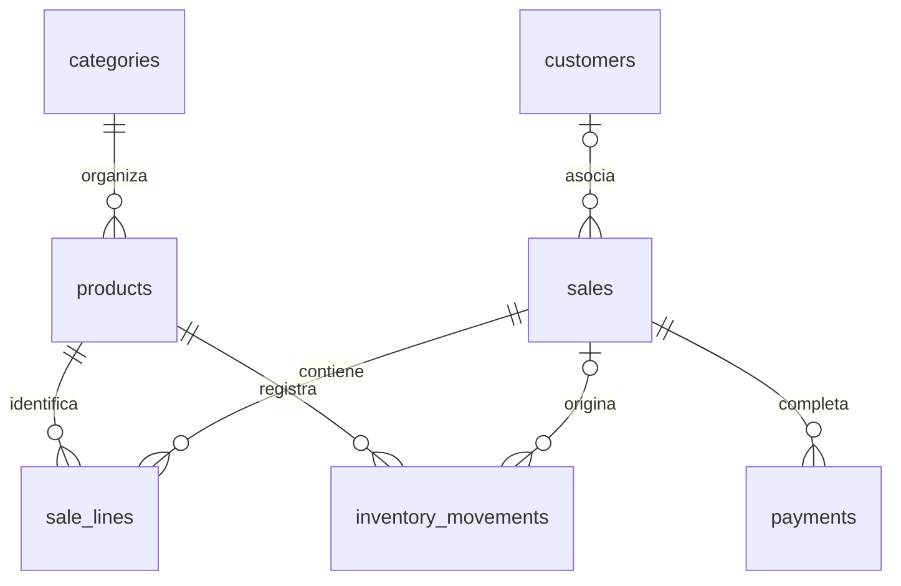

# Arquitectura y conservación de datos

## Límites

La interfaz React recibe una instancia de `Pos`. Los componentes no ejecutan SQL ni calculan totales comerciales por su cuenta. `src/domain/pos.ts` expone las operaciones de catálogo, clientes, tickets y cobro. `src/domain/money.ts` valida importes y calcula totales. `src/db/database.ts` serializa lecturas y transacciones; los dos adaptadores implementan la misma interfaz SQL.

Android utiliza `@capacitor-community/sqlite` y su SQLite/SQLCipher nativo, sin cifrado activado en esta entrega. Web utiliza `sql.js`, con su WASM incluido en el bundle; IndexedDB guarda el archivo SQLite completo después de cada transacción. No se usa localStorage ni un backend. Las fotografías se reducen a un máximo de 900 píxeles y se almacenan como datos JPEG en el producto, disponibles offline.

El navegador mantiene un Web Lock por origen durante la sesión. Una segunda pestaña recibe un aviso y no abre otro escritor. Se considera la versión web una herramienta de desarrollo y validación; Android es la plataforma objetivo. Para catálogos grandes, debe perfilarse la lectura de fotografías y el coste de exportar el archivo en web.

## Esquemas 1, 2 y 3

La migración se encuentra en `src/db/migrations.ts`. Usa `PRAGMA user_version`, claves foráneas activadas, índices y restricciones. Se aplica en una transacción; repetirla conserva los datos. Una versión de esquema posterior a la soportada impide abrir la aplicación sin borrar información.

| Tabla                 | Responsabilidad                                                                           |
| --------------------- | ----------------------------------------------------------------------------------------- |
| `categories`          | Nombre único sin distinguir mayúsculas y color                                            |
| `products`            | Catálogo, identificadores únicos no vacíos, fotografía, estado, costo, precio y stock     |
| `customers`           | Datos y observaciones del cliente                                                         |
| `sales`               | Número, estado, cliente y negocio capturados, descuento, impuesto e importes finales      |
| `sale_lines`          | Nombre y precio capturados al agregar, cantidad y notas                                   |
| `payments`            | Método, posición, referencia, aplicado, recibido y cambio; varias partes por venta en 1.1 |
| `inventory_movements` | Existencias iniciales, ajustes desde catálogo y movimientos de ventas                     |
| `settings`            | Negocio, preferencia cuadrícula/lista e identificador del ticket activo                   |

Los tickets pendientes son ventas con estado `parked`; no se duplica su contenido en otra tabla. El historial incluye únicamente estado `paid`. Las cancelaciones se conservan como `cancelled`, sin borrar filas. El esquema no inventa tablas ni funciones de módulos no implementados. Las siguientes versiones deben añadir migraciones para variantes, modificadores, devoluciones y los demás módulos pendientes.

La migración 2 renombra temporalmente la tabla de pagos anterior, crea la tabla ampliada, copia todas las filas y retira únicamente la tabla temporal al terminar la copia. Todo ocurre dentro de la misma transacción, incluida la versión de esquema. No se reconstruye ni se reinicia la base completa. Si hay un error, se restaura el estado anterior. Los pagos originales conservan todos sus campos comerciales.

`src/domain/payments.ts` valida la distribución antes de mover inventario. Se aceptan entre 1 y 10 partes; cada parte de un reparto tiene importe positivo. La suma debe ser exactamente el total. Solo `cash` admite recibido superior al aplicado; los otros métodos se registran por su importe exacto y no generan cambio. Las referencias se guardan por pago, hasta 120 caracteres. `CheckoutForm` prepara los datos y solo `Pos.checkoutPayments` los registra dentro del cierre transaccional.

El método original `Pos.checkout(saleId, tendered)` sigue disponible como cobro simple en efectivo. El recibo expone `payments` y conserva `payment` como alias de la primera parte para compatibilidad con la API 1.0. La interfaz usa la colección completa.

## Acceso, inventario y caja en esquema 3

`AccessControl` deriva PIN fuera de la cola SQL, pero confirma credenciales vigentes, contador de intentos y bloqueo dentro de una transacción. Cada operación vuelve a leer estado y permisos. La sesión solo reside en memoria y un bloqueo invalida un login todavía en curso. Los DTO de empleados no exponen hashes ni sales criptográficas. `SessionGate` mantiene la interfaz comercial cerrada hasta iniciar sesión.

`Inventory` registra movimientos con actor, motivo y antes/después. Un conteo conserva esperado y contado incluso si el delta es cero. `recordStock` es compartido por entradas/ajustes, edición del catálogo y cobros: nunca abre una transacción anidada. El promedio ponderado usa enteros y límites que preservan precisión. La consulta no carga fotografías y página el libro de movimientos.

`Cash` calcula esperado como fondo más efectivo aplicado e ingresos menos salidas/retiros. `checkoutShift` exige turno abierto solo si la opción está activa y comprueba el límite de efectivo. El cobro registra pagos, stock, empleado, turno y auditoría junto al estado pagado y nuevo borrador, en una transacción. El cierre guarda esperado/contado/diferencia una sola vez. Un índice parcial impide dos turnos abiertos. Las consultas completas requieren reportes; permisos de caja permiten solo la información necesaria para su operación.

Migración 3: tablas `employees`, `employee_permissions`, `administrative_actions`, `shifts`, `cash_movements`, `inventory_counts`; columnas `products.low_stock`, `sales.employee_id/employee_name/shift_id` y datos de trazabilidad en `inventory_movements`. No se reconstruyen antes/después ni usuarios históricos que no se guardaron. La auditoría captura nombres al escribir y nunca guarda PIN. Las migraciones y todas las operaciones siguen compartiendo la cola del adaptador.

## Ciclo de una venta

1. Al inicializar, se recupera el ticket activo o se crea uno vacío. Sus cambios se guardan inmediatamente mediante operaciones SQLite.
2. Agregar un producto captura su nombre y precio. Productos con precio y notas idénticos se agrupan; las notas diferentes conservan líneas distintas. Cambiar el catálogo no reescribe líneas ni ventas anteriores.
3. Guardar cambia el ticket a `parked` y abre uno nuevo. Recuperar un pendiente conserva automáticamente el ticket anterior si tenía artículos. No se mueve inventario.
4. Cobrar valida el estado, recalcula importes, agrupa las cantidades de cada producto, comprueba existencias, descuenta stock controlado, registra los movimientos y el pago, marca `paid` y crea el nuevo ticket, todo en una transacción.
5. El identificador del ticket actúa como clave de idempotencia. Si ya está pagado, se devuelve su recibo y no se escribe un segundo pago. La clave única `(sale_id, position)` protege cada parte y el estado `paid`, comprobado dentro de la transacción serializada, protege el conjunto completo. La interfaz también bloquea acciones durante el guardado.
6. Los fallos revierten la operación. En WASM se guarda una imagen previa para restaurar la memoria si falla la escritura en IndexedDB. No se muestra una confirmación de venta antes de que la persistencia termine.

El número de ticket se asigna al crear cada borrador; puede tener saltos por cancelaciones y borradores vacíos. No constituye un folio fiscal ni un CFDI.

## Dinero e impuestos

Importes enteros en centavos, máximo $999,999.99 MXN por importe/total; cantidades enteras de 1 a 9999. Las entradas decimales se convierten por sus dígitos, sin multiplicación flotante. Porcentajes en puntos base: 1600 representa 16.00%.

Orden: subtotal, descuento porcentual del ticket redondeado al centavo, base neta, impuesto añadido redondeado al centavo y total. El formato final es `es-MX`, con sufijo MXN. Si el negocio trabaja con precios que incluyen IVA, se configura tasa 0 en esta versión; no se desglosa un impuesto incluido.

Las ventas conservan nombre del negocio, dirección, teléfono, nombre del cliente, precio por artículo, descuento y tasa. El pie del recibo utiliza la configuración actual. Los pendientes conservan su tasa original; cambiar configuración actualiza el ticket abierto y las ventas nuevas, no pendientes ni completadas.

## Diseño estable

Barra superior verde `#49aa50`, botones GUARDAR/COBRAR `#81ae40`, catálogo a aproximadamente 69% y ticket a 31%. El ticket tiene mínimo 300 píxeles. En anchuras hasta 760 píxeles se alterna catálogo/ticket mediante un botón visible, conservando la venta. En la tableta ambos paneles permanecen visibles; cuadrícula y lista comparten las mismas operaciones. Los controles de cantidad tienen altura de 44 píxeles.

La navegación administrativa se abre desde el cajón lateral. Las categorías provienen de SQLite; Todos y Favoritos son filtros virtuales, no categorías de negocio fijas. Las imágenes usan `object-fit: cover`. El CSS contempla los insets nativos de Capacitor 8 y los del navegador. La actividad Android usa `sensorLandscape`. No cambiar este patrón ni la identidad acordada sin autorización.

## Ampliaciones

- Los anticipos confirmados con saldo pendiente requerirán un ciclo de cobro parcial adicional; la versión 1.1 confirma todos los pagos juntos. No reutilizar una clave de venta como si representara una parte independiente.
- Variantes y modificadores requieren tablas propias y capturas de lo vendido, no productos duplicados.
- Las funciones futuras deben usar `AccessControl.require` dentro de su transacción y `audit`; ocultar un botón no será suficiente.
- ESC/POS debe tener un transporte Android separado para cada conexión. Ninguna impresora se considera compatible sin una prueba real.
- Restauración debe validar integridad, versión y referencias antes de cualquier cambio de base y obtener confirmación del administrador.
